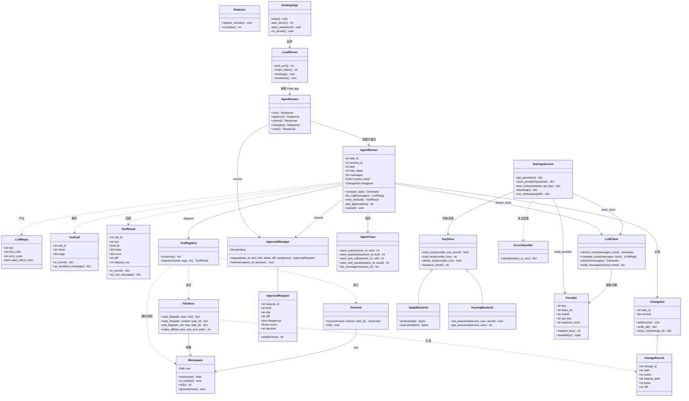
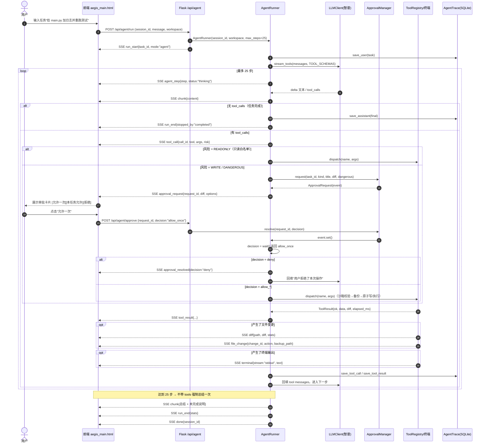
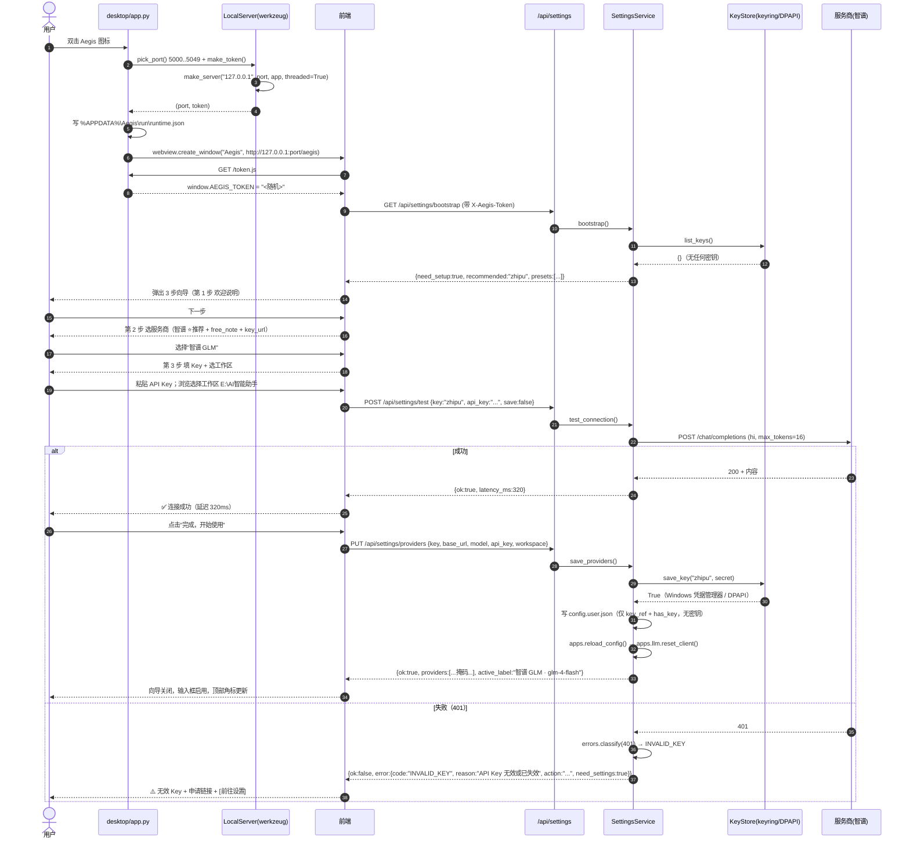
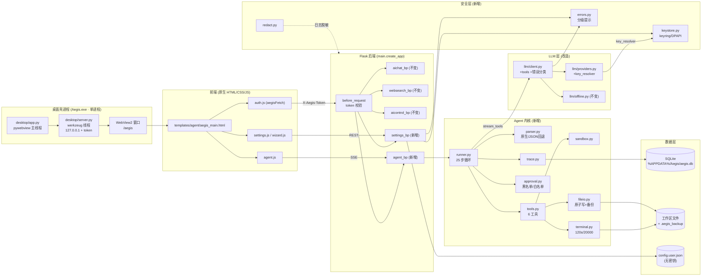
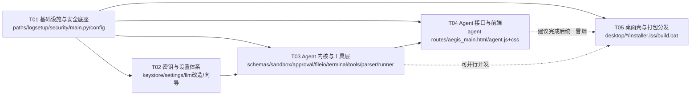

# Aegis 桌面端编码 Agent —— 系统架构设计与任务分解

| 项 | 内容 |
|---|---|
| 文档类型 | 增量架构设计（System Design + Task Breakdown） |
| 项目名 | `aegis_desktop_agent` |
| 代码包名 | **保持 `Aiagent/` 不变**（硬约束） |
| 上游输入 | `docs/PRD-桌面端编码Agent-增量.md`（P0 20 条：AG-01~11 / DK-01~04 / KY-01~05） |
| 运行环境 | Python 3.10（系统解释器）+ Flask 3.0.3 + SQLite（MySQL 不可用） |
| 版本 | v1.0（增量） |
| 作者 | 架构师 |
| 状态 | 待评审 |

> **设计总原则**：**增量叠加，不推倒重写**。现有 `apps/aichat`、`apps/llm`、`apps/websearch`、`apps/aicontrol` 的业务逻辑与对外 API 保持兼容；Agent 能力全部以**新增模块** `apps/agent/`、`apps/security/`、`apps/settings/`、`desktop/` 的方式接入。

---

## 目录

1. [实现方案与选型理由](#1-实现方案与选型理由)
2. [项目结构调整说明](#2-项目结构调整说明)
3. [文件变更清单](#3-文件变更清单)
4. [Agent 内核设计](#4-agent-内核设计)
5. [扩展的 SSE 事件协议](#5-扩展的-sse-事件协议)
6. [密钥配置体系设计](#6-密钥配置体系设计)
7. [类图 / 数据结构](#7-类图--数据结构)
8. [关键时序图](#8-关键时序图)
9. [程序调用流程图](#9-程序调用流程图)
10. [依赖包列表](#10-依赖包列表)
11. [有序任务列表](#11-有序任务列表)
12. [共享知识](#12-共享知识)
13. [待明确事项](#13-待明确事项)

---

# 1. 实现方案与选型理由

## 1.1 桌面壳选型：为什么是 pywebview，而不是 Electron / Tauri / 纯浏览器

| 候选 | 结论 | 论证 |
|---|---|---|
| **pywebview + PyInstaller + Inno Setup** | ✅ **采纳** | 见下 |
| Electron | ❌ | 必须引入 Node 工具链（node/npm/electron-builder），与「用户不想折腾环境」+「不引入 Node 构建链」双硬约束冲突；且需把 Flask 后端另起子进程并用 IPC 通信，进程模型复杂；产物 150–250MB 且需自己维护 Node 版本 |
| Tauri | ❌ | 要引入 Rust 工具链与 Node 前端构建链，违背「零前端改造」；Rust 编译环境对 Python 开发者是额外负担 |
| PyQt / PySide / wxPython | ❌ | 需重写全部前端（现有是原生 HTML/CSS/JS，约数千行），工作量不可接受 |
| 纯浏览器（`webbrowser.open`） | ❌ | 无独立窗口/无应用图标/无法控制关闭时退出后端；用户体验达不到「像一个正常软件」（US-08） |

**pywebview 的四个决定性优势：**

1. **免 Node、免 Rust**：纯 pip 安装（Windows 上自动带 `pythonnet` 依赖），与现有 Python 单体同源，构建链只有 PyInstaller 一条。
2. **前端零改造**：它直接内嵌一个 WebView 窗口加载 `http://127.0.0.1:<port>/`，现有 `templates/` + `static/`（原生 HTML/CSS/JS）**一行不用重写**，只新增文件。
3. **体积小**：Windows 上复用**系统自带的 WebView2（Edge Chromium）运行时**，不打包 Chromium，产物比 Electron 小一个数量级（预估 80–150MB，其中 Python 解释器 + 标准库占大头）。
4. **进程模型最简**：pywebview 与 Flask 跑在**同一个 Python 进程**里（见 1.2），关闭窗口直接 `server.shutdown()`，无跨进程 IPC、无僵尸进程。

**代价与对策**：依赖系统 WebView2 运行时（Win11 自带；Win10 1809+ 多数已通过 Windows Update 装上）。缺失时的对策见 1.6。

## 1.2 进程模型与线程模型（关键设计）

打包后只有一个可执行文件 `Aegis.exe`，内部是**单进程多线程**：

```
进程 Aegis.exe (Python 3.10 解释器由 PyInstaller 捆绑)
├─ 主线程        : pywebview 创建窗口 → webview.start()  （Windows 要求 UI 在主线程）
│                  窗口关闭后 → server.shutdown() → os._exit(0)
├─ 线程 T-server : werkzeug.serving.make_server("127.0.0.1", port, app, threaded=True)
│                  server.serve_forever()  （daemon 线程）
├─ 线程 T-req*   : Flask/Werkzeug 每请求一线程（threaded=True）
│                  → SSE 生成器（Agent 主循环）就跑在其中某一个 T-req 上
├─ 线程 T-stderr : 命令执行时收集 subprocess 的 stderr（防管道阻塞）
└─ 子进程 P-cmd  : run_command 拉起的 shell（可被 taskkill / killpg 杀进程树）
```

**关键约束（必须遵守，否则会死锁）**：
- Flask 必须 `threaded=True`。因为 Agent 主循环在 SSE 请求线程里**同步阻塞等待审批**（`threading.Event.wait`），而用户的「允许/拒绝」是**另一个 HTTP 请求**；若服务是单线程的，approve 请求永远排不到队 → 死锁。
- 后端服务用 `werkzeug.serving.make_server`（Flask 自带，不新增依赖）而非 `app.run()`，因为需要拿到 server 对象的 `shutdown()` 做优雅退出。`debug=False`、`use_reloader=False`。
- `run_command` 的 stdout 由 SSE 线程**逐行读取并即时 yield** `terminal` 事件；stderr 交给 T-stderr 收集，避免管道缓冲区打满导致子进程卡死。

## 1.3 Agent 内核：双通道工具调用

- **通道 A（原生 Function Calling）**：`apps/llm/client.py::_payload()` 增加 `tools` 字段，解析 `choices[0].delta.tool_calls`。
- **通道 B（JSON 回退）**：对不支持（或不确定支持）`tools` 的模型，用系统提示词约束输出 ```json 代码块，由 `apps/agent/parser.py` 做平衡括号提取 + 校验。
- **运行时探测**（解决 PRD Q5）：`PRESETS` 增加 `supports_tools` 字段（`"native" | "none" | "unknown"`）。`unknown` 时先走通道 A；若返回 400/404 且错误体含 `tools`/`function`/`tool` 关键词 → 判定不支持，把结论缓存进 `config.user.json::provider_caps`，本次任务立即切换到通道 B。**无需用户判断，无需重启**。

## 1.4 安全模型（四道闸）

| 闸 | 位置 | 作用 |
|---|---|---|
| ① 本地鉴权 | `main.py::before_request` | 随机 token，所有 `/api/*` 校验 `X-Aegis-Token`，无 token → 401 |
| ② 路径沙箱 | `apps/agent/sandbox.py` | 所有路径 `Path.resolve()` 归一化（展开 `..` 与符号链接）后必须落在工作区内 |
| ③ 命令分级 | `apps/agent/approval.py` | 黑名单（无条件二次确认且不可豁免）→ 只读白名单（自动放行）→ 其余（写操作需确认） |
| ④ 写入兜底 | `apps/agent/fileio.py` | 原子写（`tmp` + `os.replace`）+ 任务级备份 + 变更清单 + 一键撤销 |

## 1.5 分发与数据落盘

- **打包**：PyInstaller **one-dir**（启动快、便于后续增量替换），再由 Inno Setup 打成 `Aegis-Setup-x.y.z.exe`。
- **不签名**（Q7），随包提供 SmartScreen 绕过说明（「更多信息 → 仍要运行」）。
- **数据目录**：`%APPDATA%\Aegis\`（Windows）/ `~/Library/Application Support/Aegis/`（macOS），由 `apps/paths.py` 用标准库实现（不引 `platformdirs`）。数据库、密钥库、用户配置、滚动日志全部落这里，安装目录只读，普通用户权限即可运行（US-10 / AEG-D06）。

## 1.6 WebView2 缺失时的引导

`desktop/app.py` 启动时探测 pywebview 能否创建窗口；失败（通常是缺 WebView2 Runtime）→ 弹原生消息框提示「需要安装 WebView2 运行时」，并提供 Evergreen Bootstrapper 官方下载链接按钮。应用**不再静默失败**（对齐 US-13 的「不沉默失败」精神）。

---

# 2. 项目结构调整说明

## 2.1 改造前

```
E:\AI智能助手\
└── Aiagent/
    ├── main.py                     # Flask 工厂 + 页面路由 + __main__
    ├── apps/
    │   ├── __init__.py             # CONFIG / DB / api_ok / api_fail / logger
    │   ├── aichat/                 # 会话·消息·记忆·SSE 聊天
    │   ├── aicontrol/              # 合规规则 CRUD
    │   ├── llm/                    # 服务商切换 / 预设 / 离线兜底
    │   └── websearch/              # 联网检索 + 天气
    ├── config/config.json
    ├── static/{css,js}
    ├── templates/{main.html,aichat/,aicontrol/}
    ├── requirements.txt
    └── docs/
```

## 2.2 改造后（★ 新增 / ✎ 修改 / · 不变）

```
E:\AI智能助手\
└── Aiagent/
    ├── main.py                        ✎ 注册新 BP；host→127.0.0.1；debug→False；CORS 收紧；token 校验；/aegis、/token.js
    ├── apps/
    │   ├── __init__.py                ✎ 用户级配置合并；DB 路径→用户目录；reload_config()；日志初始化；message metadata 列迁移
    │   ├── paths.py                   ★ 用户数据目录 / 日志目录 / 端口与 token 运行时文件
    │   ├── logsetup.py                ★ 滚动日志 + 密钥脱敏 Filter
    │   ├── agent/                     ★★★ 编码 Agent 内核（全部新增）
    │   │   ├── __init__.py            ★ Blueprint agent_bp  /api/agent
    │   │   ├── schemas.py             ★ 6 个工具的 JSON Schema + 别名映射
    │   │   ├── sandbox.py             ★ 工作区路径沙箱 + 忽略规则
    │   │   ├── approval.py            ★ 审批策略 / 黑名单 / 只读白名单 / ApprovalManager
    │   │   ├── fileio.py              ★ 原子写 / 备份 / 撤销 / unified diff
    │   │   ├── terminal.py            ★ run_command 子进程执行（超时·中断·截断·编码）
    │   │   ├── tools.py               ★ 6 个工具实现 + 统一 dispatch
    │   │   ├── prompts.py             ★ Agent 系统提示词（原生/JSON 回退两套）
    │   │   ├── parser.py              ★ tool_calls 解析（原生 + JSON 回退 + 重试纠错）
    │   │   ├── runner.py              ★ 多步编排循环（上限 25 步）
    │   │   ├── trace.py               ★ 轨迹持久化（复用 ai_chat_message）
    │   │   └── routes.py              ★ /run(SSE) /approve /cancel /changes /undo
    │   ├── security/                  ★★★ 密钥与脱敏（全部新增）
    │   │   ├── __init__.py            ★
    │   │   ├── keystore.py            ★ save/load/delete/list 抽象（keyring 优先）
    │   │   ├── dpapi.py               ★ Windows ctypes DPAPI 回退实现
    │   │   ├── redact.py              ★ 日志/响应密钥脱敏
    │   │   └── errors.py              ★ 分级错误分类（8 类）
    │   ├── settings/                  ★★★ 运行时配置（全部新增）
    │   │   ├── __init__.py            ★ Blueprint settings_bp /api/settings
    │   │   ├── services.py            ★ 配置读写 / 测试连接 / bootstrap / 工作区选择
    │   │   └── routes.py              ★
    │   ├── llm/
    │   │   ├── providers.py           ✎ key_resolver 钩子；supports_tools；recommended
    │   │   ├── client.py              ✎ tools 支持；stream_tools/complete_tools；错误分类接入
    │   │   ├── __init__.py            ✎ 导出新函数
    │   │   └── offline.py             · 不变
    │   ├── aichat/
    │   │   ├── services.py            ✎ save_message 扩展 message_type/metadata
    │   │   ├── routes.py              ✎ /messages 返回 metadata
    │   │   └── memory.py              · 不变
    │   ├── aicontrol/                 · 不变（3 个文件）
    │   └── websearch/                 · 不变（5 个文件）
    ├── desktop/                       ★★★ 桌面壳与打包（全部新增）
    │   ├── __init__.py                ★
    │   ├── app.py                     ★ 启动器：探端口→起服务→开窗口→优雅退出
    │   ├── server.py                  ★ make_server / 端口探测 / token 生成 / 单实例探测
    │   ├── build.spec                 ★ PyInstaller 配置
    │   ├── build.bat                  ★ 一键构建
    │   ├── installer.iss              ★ Inno Setup 安装包脚本
    │   ├── requirements-desktop.txt   ★ 桌面端依赖
    │   └── README-打包与分发.md        ★ 构建/签名/分发说明
    ├── config/
    │   └── config.json                ✎ host/debug 修正；新增 agent/security/desktop 段；零密钥
    ├── static/
    │   ├── js/
    │   │   ├── auth.js                ★ token 注入 + aegisFetch 封装
    │   │   ├── agent.js               ★ Agent 面板 + Agent 模式 SSE 消费
    │   │   ├── settings.js            ★ 服务商配置弹窗 + 测试连接
    │   │   ├── wizard.js              ★ 首次启动向导（3 步）
    │   │   ├── main.js                ✎ 未知事件忽略；fetch 走 aegisFetch；顶部 Aegis 入口
    │   │   └── common/chat/aichat/aicontrol.js  · 不变
    │   └── css/
    │       ├── agent.css              ★ Agent 面板 / 工具卡片 / 审批卡片 / diff
    │       ├── settings.css           ★ 设置弹窗 + 向导
    │       └── common/main/chat/aichat/aicontrol.css  · 不变
    ├── templates/
    │   ├── agent/
    │   │   ├── aegis_main.html        ★ Aegis 主界面（三栏：会话 / 对话 / Agent 工作区）
    │   │   ├── _settings_modal.html   ★ 服务商设置弹窗（Jinja partial）
    │   │   └── _wizard.html           ★ 首次启动向导（Jinja partial）
    │   ├── main.html                  ✎ 引入 token.js / auth.js（2 行）
    │   └── aichat/, aicontrol/        · 不变
    ├── requirements.txt               ✎ 追加 pywebview / keyring
    └── docs/
        ├── DESIGN-桌面端编码Agent-架构.md   ★ 本文档
        ├── class-diagram.mermaid           ★ 类图源文件
        └── sequence-diagram.mermaid        ★ 时序图源文件
```

## 2.3 运行时数据目录（不进代码库、不进安装包）

```
%APPDATA%\Aegis\                       (Windows)
~/Library/Application Support/Aegis/   (macOS)
├── aegis.db                 # SQLite：会话/消息/记忆（运行时自动创建）
├── config.user.json         # 用户级配置（不含任何密钥）
├── secrets 由系统托管         # Windows 凭据管理器 / macOS Keychain（非文件）
├── run/
│   └── runtime.json         # {port, token, pid, started_at}（0600 权限）
└── logs/
    └── aegis.log            # RotatingFileHandler 5MB × 3
```

---

# 3. 文件变更清单

> 变更类型：**新增** / **修改** / **不变**。「依赖谁」只列直接依赖。

## 3.1 Python 后端 —— 新增（22 个）

| 文件路径 | 变更类型 | 职责 | 依赖谁 |
|---|---|---|---|
| `Aiagent/apps/paths.py` | 新增 | 用户数据目录、日志目录、`runtime.json` 读写、端口候选；零第三方依赖（标准库实现） | `os`/`pathlib`/`json` |
| `Aiagent/apps/logsetup.py` | 新增 | `RotatingFileHandler`(5MB×3) + 控制台 handler + 密钥脱敏 Filter | `apps/paths`、`apps/security/redact` |
| `Aiagent/apps/security/__init__.py` | 新增 | 导出 keystore / redact / errors | — |
| `Aiagent/apps/security/keystore.py` | 新增 | `save_key/load_key/delete_key/list_keys`；`keyring` 优先，DPAPI/Keychain 回退，末位混淆级降级 | `keyring`、`apps/security/dpapi` |
| `Aiagent/apps/security/dpapi.py` | 新增 | Windows `CryptProtectData/CryptUnprotectData` ctypes 实现（不依赖 pywin32） | `ctypes` |
| `Aiagent/apps/security/redact.py` | 新增 | 登记/注销敏感串；logging.Filter 替换；响应体脱敏 | — |
| `Aiagent/apps/security/errors.py` | 新增 | 分级错误分类 8 类 → `{code, reason, action, retryable, need_settings}` | — |
| `Aiagent/apps/settings/__init__.py` | 新增 | `settings_bp`（`/api/settings`）+ import routes | `flask` |
| `Aiagent/apps/settings/services.py` | 新增 | 服务商配置读写、测试连接、`bootstrap`、工作区选择、保存后 `reload_config()+reset_client()` | `apps/llm`、`apps/security`、`apps/paths` |
| `Aiagent/apps/settings/routes.py` | 新增 | `/providers` CRUD、`/test`、`/workspace`、`/bootstrap`、`/export` | `apps/settings/services` |
| `Aiagent/apps/agent/__init__.py` | 新增 | `agent_bp`（`/api/agent`）+ import routes | `flask` |
| `Aiagent/apps/agent/schemas.py` | 新增 | 6 工具 JSON Schema + `TOOL_ALIASES` + 中文标签 | — |
| `Aiagent/apps/agent/sandbox.py` | 新增 | `Workspace` 类：resolve / is_inside / 忽略规则 / 目录树裁剪 | `pathlib` |
| `Aiagent/apps/agent/approval.py` | 新增 | 危险黑名单、只读白名单、风险分级、`ApprovalManager`（Event 挂起/恢复） | `threading`、`re` |
| `Aiagent/apps/agent/fileio.py` | 新增 | 原子写、`.aegis_backup/<task_id>/` 备份、`ChangeSet` 记录与撤销、`unified_diff` | `difflib`、`apps/agent/sandbox` |
| `Aiagent/apps/agent/terminal.py` | 新增 | `run_command` 子进程：cwd=工作区、120s 超时、20000 字符截断、可中断、UTF-8/GBK 解码、杀进程树 | `subprocess`、`apps/agent/sandbox` |
| `Aiagent/apps/agent/tools.py` | 新增 | `read_file/list_dir/search_code/write_file/edit_file/run_command` 实现 + `dispatch()` | sandbox/fileio/terminal/approval |
| `Aiagent/apps/agent/prompts.py` | 新增 | Agent 系统提示词（原生工具版 / JSON 回退版）+ 工作区摘要注入 + 中文 UI 文案 | `apps/agent/schemas` |
| `Aiagent/apps/agent/parser.py` | 新增 | 原生 `tool_calls` 解析 + JSON 回退提取（平衡括号/代码块）+ 一次纠错重试 | `json`、`apps/agent/schemas` |
| `Aiagent/apps/agent/runner.py` | 新增 | `AgentRunner`：25 步循环、工具回填、审批挂起、取消、终止条件、SSE 事件产出 | 全部 agent/*、`apps/llm` |
| `Aiagent/apps/agent/trace.py` | 新增 | 轨迹落 `ai_chat_message`（`message_type` 扩展 + `metadata` JSON） | `apps.aichat.services`、`apps` |
| `Aiagent/apps/agent/routes.py` | 新增 | `/run`(SSE)、`/approve`、`/cancel`、`/changes`、`/undo`、`/tools` | runner/approval/fileio |

## 3.2 桌面端 —— 新增（8 个）

| 文件路径 | 变更类型 | 职责 | 依赖谁 |
|---|---|---|---|
| `Aiagent/desktop/__init__.py` | 新增 | 包声明 | — |
| `Aiagent/desktop/app.py` | 新增 | 入口：单实例探测 → 起服务 → pywebview 开窗 → 关闭时 shutdown → WebView2 缺失引导 | `desktop/server`、`webview` |
| `Aiagent/desktop/server.py` | 新增 | `make_server("127.0.0.1", port, app, threaded=True)`；端口探测 5000–5049；生成 token；写 `runtime.json` | `werkzeug`、`apps/paths`、`main.create_app` |
| `Aiagent/desktop/build.spec` | 新增 | PyInstaller 配置：hiddenimports、datas（templates/static/config）、console=False | — |
| `Aiagent/desktop/build.bat` | 新增 | 一键构建：`pip install -r requirements-desktop.txt` → `pyinstaller build.spec` → `iscc installer.iss` | — |
| `Aiagent/desktop/installer.iss` | 新增 | Inno Setup：安装目录 `Aegis`、开始菜单/桌面快捷方式、卸载项、版本与发布者、卸载保留用户数据 | — |
| `Aiagent/desktop/requirements-desktop.txt` | 新增 | 桌面端依赖（含 PyInstaller，构建机专用） | — |
| `Aiagent/desktop/README-打包与分发.md` | 新增 | 构建步骤、体积说明、SmartScreen 绕过、卸载与数据保留说明 | — |

## 3.3 前端 —— 新增（8 个）

| 文件路径 | 变更类型 | 职责 | 依赖谁 |
|---|---|---|---|
| `Aiagent/static/js/auth.js` | 新增 | 从 `/token.js` 拿 token；`aegisFetch()` 自动带 `X-Aegis-Token` 与 401 处理 | — |
| `Aiagent/static/js/agent.js` | 新增 | Agent 模式：发起 `/api/agent/run`、SSE 事件分支渲染、步骤/工具卡片/审批卡片/终端面板、approve/cancel/undo 交互 | `auth.js`、`DOM` |
| `Aiagent/static/js/settings.js` | 新增 | 服务商设置弹窗：下拉（来自 `PRESETS`）、掩码显示/隐藏、测试连接、故障切换链排序、保存 | `auth.js` |
| `Aiagent/static/js/wizard.js` | 新增 | 首次启动向导 3 步（欢迎 → 选服务商 → 填 Key + 选工作区 + 测试） | `auth.js`、`settings.js` |
| `Aiagent/static/css/agent.css` | 新增 | 三栏布局、步骤列表、工具卡片、审批卡片、diff `<pre>`、终端面板（沿用既有配色变量） | `common.css` |
| `Aiagent/static/css/settings.css` | 新增 | 设置弹窗、表单、向导步骤条、状态灯 | `common.css` |
| `Aiagent/templates/agent/aegis_main.html` | 新增 | Aegis 主界面骨架（左会话 / 中对话 / 右 Agent 工作区）+ 引入 js/css | partials、`powered_by` |
| `Aiagent/templates/agent/_settings_modal.html` | 新增 | 设置弹窗 DOM（Jinja partial，``） | — |
| `Aiagent/templates/agent/_wizard.html` | 新增 | 向导 DOM（Jinja partial） | — |

## 3.4 文档 —— 新增（3 个）

| 文件路径 | 变更类型 | 职责 | 依赖谁 |
|---|---|---|---|
| `Aiagent/docs/DESIGN-桌面端编码Agent-架构.md` | 新增 | 本文档 | — |
| `Aiagent/docs/class-diagram.mermaid` | 新增 | 类图源文件（便于后续维护） | — |
| `Aiagent/docs/sequence-diagram.mermaid` | 新增 | 时序图源文件 | — |

## 3.5 修改（11 个）

| 文件路径 | 变更类型 | 改动要点 | 依赖谁 |
|---|---|---|---|
| `Aiagent/main.py` | 修改 | ①注册 `agent_bp`/`settings_bp`；②`CORS(app, resources={r"/api/*": {"origins": 本机来源}})`；③`before_request` 校验 `X-Aegis-Token`（仅 `/api/*`，页面与静态放行）；④新增 `/aegis`（渲染 `agent/aegis_main.html`）与 `/token.js`（下发 `window.AEGIS_TOKEN`）；⑤`inject_global` 增加 `aegis_token` 与 `bootstrap`；⑥`__main__` 改为 `127.0.0.1` + `debug=False` | `apps.agent`、`apps.settings`、`apps/paths` |
| `Aiagent/apps/__init__.py` | 修改 | ①`load_config()` 支持 `config.default.json` + `%APPDATA%\Aegis\config.user.json` 深合并（用户级优先）；②新增 `reload_config()`（**原地 `CONFIG.clear()+update`**，保证旧的 `from apps import CONFIG` 引用仍有效）；③SQLite 路径改为 `apps/paths.db_path()`；④`_detect_db_type` 桌面端默认 `sqlite`（`db_type` 可配回 mysql）；⑤`_init_sqlite` 增加 `ALTER TABLE ai_chat_message ADD COLUMN metadata TEXT` 兼容迁移；⑥启动时调用 `logsetup.setup()` | `apps/paths`、`apps/logsetup` |
| `Aiagent/apps/llm/providers.py` | 修改 | ①`PRESETS` 每项增加 `supports_tools`（`native/none/unknown`）与 `recommended`（智谱为 `true`）；②新增模块级 `register_key_resolver(fn)` 与 `_KEY_RESOLVER`；③`build_provider()` 的 key 解析改为 `cfg → env → resolver()`；④新增 `build_provider_from(dict)` 供测试连接用临时实例 | `os` |
| `Aiagent/apps/llm/client.py` | 修改 | ①`_payload()` 增加可选 `tools`；②新增 `stream_tools(messages, tools)` / `complete_tools(messages, tools)`，返回 `tool_calls` 事件；③`_stream_one` 解析 `delta.tool_calls` 并产出 `{"type":"tool_call_delta"}`；④失败原因改为 `apps.security.errors.classify()` 输出结构化错误；⑤支持「本次不使用离线兜底」开关（Agent 需要真实模型） | `apps/security/errors` |
| `Aiagent/apps/llm/__init__.py` | 修改 | 导出 `register_key_resolver`、`stream_tools` 相关入口（保持 `get_client/reset_client/get_status/get_active_label` 签名不变） | — |
| `Aiagent/apps/aichat/services.py` | 修改 | `save_message(session_id, role, content, message_type="text", metadata=None)`（向后兼容），新增 `save_agent_message()` | `apps` |
| `Aiagent/apps/aichat/routes.py` | 修改 | `/sessions/<id>/messages` 返回值增加 `metadata` 字段（前端据此渲染历史工具卡片） | `apps.aichat.services` |
| `Aiagent/config/config.json` | 修改 | `app.host→"127.0.0.1"`、`app.debug→false`；新增 `agent`、`security`、`desktop` 段；**确认零密钥字段** | — |
| `Aiagent/requirements.txt` | 修改 | 追加 `pywebview`、`keyring`（构建相关依赖放 `desktop/requirements-desktop.txt`） | — |
| `Aiagent/static/js/main.js` | 修改 | ①顶部增加「进入 Aegis」入口；②`fetch` 改走 `aegisFetch`；③`handleEvent` 对未知事件 `type` 直接忽略（保证旧页面不报错）；④`blocked`/`error` 分支接入分级提示 | `auth.js` |
| `Aiagent/templates/main.html` | 修改 | 增加 2 行：`<script src="/token.js"></script>`、`<script src="/static/js/auth.js"></script>` | — |

## 3.6 不变（明确不动，14 个文件）

| 文件路径 | 变更类型 | 说明 |
|---|---|---|
| `Aiagent/apps/aicontrol/{__init__,routes,services}.py` | 不变 | 合规规则模块保留；Agent 仅复用 `check_compliance()` |
| `Aiagent/apps/websearch/{__init__,routes,services,weather}.py` | 不变 | 联网检索保留为「联网」开关；Agent 不改动它 |
| `Aiagent/apps/aichat/memory.py` | 不变 | 长期记忆原样复用 |
| `Aiagent/apps/llm/offline.py` | 不变 | 离线兜底原样保留 |
| `Aiagent/static/js/{common,chat,aichat,aicontrol}.js` | 不变 | 旧页面脚本不动 |
| `Aiagent/static/css/{common,main,chat,aichat,aicontrol}.css` | 不变 | 新增样式独立文件，不污染既有 |
| `Aiagent/templates/aichat/*.html`、`Aiagent/templates/aicontrol/*.html` | 不变 | 旧页面不动 |

## 3.7 统计

| 类型 | 数量 |
|---|---|
| **新增** | **41**（Python 22 + 桌面端 8 + 前端 9 + 文档 3；其中前端实为 9 个：`auth/agent/settings/wizard` js + `agent/settings` css + `aegis_main/_settings_modal/_wizard` html） |
| **修改** | **11** |
| **不变** | **14**（豁免改造，保持兼容） |

---

# 4. Agent 内核设计

## 4.1 六个工具的 JSON Schema

统一规范：**工具规范名采用 `read_file / list_dir / search_code / write_file / edit_file / run_command`**；PRD 中的 `grep_search`、`replace_in_file` 作为**同义别名**登记在 `TOOL_ALIASES`，模型若输出旧名会自动归一（低成本换取鲁棒性）。

所有工具的相对路径 `path` **一律相对于工作区根目录**，不允许绝对路径（传入绝对路径也先转相对再校验）。

### ① read_file

```json
{
  "type": "function",
  "function": {
    "name": "read_file",
    "description": "读取工作区内一个文本文件的内容（带行号）。用于查看源码、配置、日志。",
    "parameters": {
      "type": "object",
      "properties": {
        "path":        { "type": "string",  "description": "相对工作区根目录的路径，如 apps/agent/tools.py" },
        "start_line":  { "type": "integer", "minimum": 1, "description": "起始行（含），默认 1" },
        "end_line":    { "type": "integer", "minimum": 1, "description": "结束行（含），默认文件末尾" }
      },
      "required": ["path"],
      "additionalProperties": false
    }
  }
}
```

**示例入参**：`{"path": "apps/llm/client.py", "start_line": 140, "end_line": 160}`

**返回（成功）**：
```json
{
  "ok": true, "tool": "read_file",
  "data": {
    "path": "apps/llm/client.py",
    "total_lines": 346,
    "start_line": 140, "end_line": 160,
    "truncated": false,
    "content": "140\t    def _payload(self, p: Provider, messages: List[dict], stream: bool) -> dict:\n..."
  },
  "error": null
}
```

**返回（失败）**：
```json
{ "ok": false, "tool": "read_file", "data": null,
  "error": { "code": "PATH_OUT_OF_WORKSPACE", "message": "路径超出工作区范围，已拒绝读取" } }
```
错误码枚举：`PATH_OUT_OF_WORKSPACE` / `FILE_NOT_FOUND` / `NOT_A_FILE` / `BINARY_FILE` / `TOO_LARGE` / `ENCODE_ERROR` / `INVALID_ARGUMENT`。

> 截断策略：单文件 > **2000 行**自动分段，返回前 2000 行并置 `truncated=true`，UI 提示「已截断」；单文件 > 2MB 直接拒绝（`TOO_LARGE`），建议改用 `search_code`。

### ② list_dir

```json
{
  "type": "function",
  "function": {
    "name": "list_dir",
    "description": "列出工作区内某个目录的文件树（自动忽略 .git/node_modules/__pycache__/.venv 等）。",
    "parameters": {
      "type": "object",
      "properties": {
        "path":         { "type": "string",  "description": "相对目录，默认 '.'（工作区根）" },
        "max_depth":    { "type": "integer", "minimum": 1, "maximum": 5, "default": 2 },
        "max_entries":  { "type": "integer", "minimum": 10, "maximum": 2000, "default": 300 }
      },
      "required": [],
      "additionalProperties": false
    }
  }
}
```

**返回**：
```json
{
  "ok": true, "tool": "list_dir",
  "data": {
    "path": ".",
    "entries": [
      { "name": "apps",  "type": "dir",  "size": null },
      { "name": "main.py", "type": "file", "size": 4210 }
    ],
    "tree": "apps/\n  agent/\n    tools.py\nmain.py\n",
    "truncated": false
  },
  "error": null
}
```

### ③ search_code（别名 `grep_search`）

```json
{
  "type": "function",
  "function": {
    "name": "search_code",
    "description": "在工作区内检索代码/文本（关键词或正则），返回 文件:行号:内容。",
    "parameters": {
      "type": "object",
      "properties": {
        "pattern":        { "type": "string",  "description": "关键词或正则表达式" },
        "path":           { "type": "string",  "description": "检索起始目录，默认 '.'" },
        "file_glob":      { "type": "string",  "description": "文件名过滤，如 '*.py'，默认 '*'" },
        "regex":          { "type": "boolean", "default": false, "description": "pattern 是否为正则" },
        "case_sensitive": { "type": "boolean", "default": false },
        "max_results":    { "type": "integer", "minimum": 1, "maximum": 500, "default": 50 }
      },
      "required": ["pattern"],
      "additionalProperties": false
    }
  }
}
```

**返回**：
```json
{
  "ok": true, "tool": "search_code",
  "data": {
    "pattern": "def _payload",
    "matches": [
      { "path": "apps/llm/client.py", "line": 142, "text": "    def _payload(self, p: Provider, messages: List[dict], stream: bool) -> dict:" }
    ],
    "total": 1, "truncated": false
  },
  "error": null
}
```

### ④ write_file

```json
{
  "type": "function",
  "function": {
    "name": "write_file",
    "description": "新建文件或整文件覆盖写入（会先备份原文件）。小改动请优先用 edit_file。",
    "parameters": {
      "type": "object",
      "properties": {
        "path":        { "type": "string", "description": "相对工作区根目录的文件路径" },
        "content":    { "type": "string", "description": "完整文件内容" },
        "create_dirs": { "type": "boolean", "default": true, "description": "父目录不存在时自动创建" }
      },
      "required": ["path", "content"],
      "additionalProperties": false
    }
  }
}
```

**返回**：
```json
{
  "ok": true, "tool": "write_file",
  "data": {
    "path": "apps/agent/notes.md",
    "action": "created",
    "bytes": 128,
    "backup_path": ".aegis_backup/t-8f3a1c/apps/agent/notes.md",
    "change_id": 3
  },
  "error": null
}
```
`action`: `created` | `overwritten`。错误码增加 `WRITE_DENIED`（用户拒绝）、`BACKUP_FAILED`（备份失败即中止，绝不裸写）。

### ⑤ edit_file（别名 `replace_in_file`）

```json
{
  "type": "function",
  "function": {
    "name": "edit_file",
    "description": "对文件做精确字符串替换（old_text 必须在文件中唯一匹配，否则报错不猜测）。",
    "parameters": {
      "type": "object",
      "properties": {
        "path":       { "type": "string", "description": "相对工作区根目录的文件路径" },
        "old_text":  { "type": "string", "description": "待替换的原文（含缩进，必须唯一）" },
        "new_text":  { "type": "string", "description": "替换后的新文本" },
        "occurrence": { "type": "integer", "minimum": 1, "default": 1, "description": "匹配到多处时指定第几处（不填则要求唯一）" }
      },
      "required": ["path", "old_text", "new_text"],
      "additionalProperties": false
    }
  }
}
```

**返回**：
```json
{
  "ok": true, "tool": "edit_file",
  "data": {
    "path": "main.py", "action": "modified",
    "backup_path": ".aegis_backup/t-8f3a1c/main.py",
    "diff": "--- a/main.py\n+++ b/main.py\n@@ -124,7 +124,7 @@\n-        debug=app_cfg.get(\"debug\", True),\n+        debug=app_cfg.get(\"debug\", False),",
    "stats": { "added": 1, "removed": 1 },
    "change_id": 5
  },
  "error": null
}
```

**失败（关键验收点 AG-03②）**：
```json
{ "ok": false, "tool": "edit_file", "data": null,
  "error": { "code": "MATCH_NOT_UNIQUE",
             "message": "old_text 在文件中匹配到 3 处，已拒绝修改。请补充更多上下文使其唯一，或指定 occurrence。",
             "detail": { "count": 3, "lines": [18, 47, 129] } } }
```

### ⑥ run_command

```json
{
  "type": "function",
  "function": {
    "name": "run_command",
    "description": "在工作区根目录下执行一条终端命令（始终以工作区为 cwd，禁止 cd 逃逸）。",
    "parameters": {
      "type": "object",
      "properties": {
        "command": { "type": "string", "description": "要执行的命令原文，如 'python -m pytest -q'" },
        "timeout": { "type": "integer", "minimum": 1, "maximum": 600, "default": 120, "description": "超时秒数，默认 120" },
        "risk":    { "type": "string", "enum": ["auto", "read", "write"], "default": "auto", "description": "风险声明；auto 由后端判定" }
      },
      "required": ["command"],
      "additionalProperties": false
    }
  }
}
```

**返回**：
```json
{
  "ok": true, "tool": "run_command",
  "data": {
    "command": "python -m pytest -q", "cwd": "E:/AI智能助手",
    "exit_code": 0, "duration_ms": 3210, "timed_out": false,
    "stdout": "............\n12 passed in 3.21s\n",
    "stderr": "",
    "truncated": false, "truncated_at": 20000
  },
  "error": null
}
```
错误码：`COMMAND_BLACKLIST`（命中黑名单）、`PATH_OUT_OF_WORKSPACE`（命令内含工作区外绝对路径）、`TIMEOUT`、`INTERRUPTED`、`SPAWN_FAILED`。

## 4.2 工具调用编排循环

### 4.2.1 主循环伪代码（`apps/agent/runner.py`）

```python
class AgentRunner:
    def run(self, user_task: str) -> Generator[dict, None, None]:
        messages = self._init_messages(user_task)      # system(agent+workspace摘要) + history + user
        yield {"type": "run_start", "task_id": ..., "mode": "agent", "workspace": ...}

        for step in range(1, self.max_steps + 1):      # max_steps 默认 25（Q13）
            if self.cancel_event.is_set(): break
            yield {"type": "agent_step", "step": step, "status": "thinking"}

            reply = self._llm_call(messages)           # 原生 tools 或 JSON 回退
            if reply.text: yield {"type": "chunk", "content": reply.text}
            if reply.error: yield {"type":"error", ...}; break

            if not reply.tool_calls:                    # ① 不再请求工具 → 任务结束
                self._finish(messages, reply.text); break

            for call in reply.tool_calls:               # ② 串行执行（保证审批顺序与因果）
                yield {"type": "tool_call", "step": step, **call.to_event()}
                result = self._execute(call)            # 含审批挂起、沙箱校验、备份
                yield {"type": "tool_result", "step": step, **result.to_event()}
                if result.diff:  yield {"type": "diff", ...}
                if result.file_change: yield {"type": "file_change", ...}
                messages.append(call.as_assistant_message())
                messages.append(result.as_tool_message())

            if self._tool_errors >= self.max_tool_errors:   # 连续 3 次工具报错 → 收敛
                yield {"type":"notice", ...}; break
        else:
            # ③ 达到 25 步上限：不带 tools 再要一次「总结 + 未完成说明」
            summary = self._force_summary(messages)
            yield {"type": "chunk", "content": summary}

        yield {"type": "run_end", "task_id": ..., "stats": {...}}
```

### 4.2.2 如何给 LLM 传 tools

- **通道 A**：`_payload()` 追加
  ```python
  payload["tools"] = TOOL_SCHEMAS           # 6 个 OpenAI function 定义
  payload["tool_choice"] = "auto"
  ```
- **通道 B**：不传 `tools`，改在 system 提示词末尾注入（`apps/agent/prompts.py::JSON_FALLBACK_SUFFIX`）：
  ```
  当你需要调用工具时，必须只输出一个 ```json 代码块，格式为：
  {"thought":"简短思考","tool":"<工具名>","args":{...}}
  当你认为任务已完成时，输出：{"thought":"...","final":"给用户的最终答复"}
  不要在这之外输出任何其他内容。
  ```

### 4.2.3 解析 tool_calls

| 来源 | 解析方式 | 失败处理 |
|---|---|---|
| 原生 `delta.tool_calls[]` | 累积 `id / name / arguments(增量拼接)`，收到 `finish_reason=stop` 后 `json.loads(arguments)` | JSON 解析失败 → 视为 `INVALID_ARGUMENT` 工具结果回填，让模型重试（最多 2 次） |
| JSON 回退文本 | ①优先取最后一个 ```json 代码块；②否则用**括号平衡扫描**提取首个完整 `{...}`；③`json.loads` 后校验 `tool` 在白名单、`args` 符合 Schema 必填项 | 找不到/解析失败 → 回填 `{"ok":false,"error":{"code":"PARSE_FAILED"}}` + 提示「请只输出一个 JSON 代码块」，重试 1 次；仍失败则结束任务并汇报 |

### 4.2.4 工具结果回填 messages

```python
# assistant 消息（携带工具调用）
{"role": "assistant",
 "content": reply.text or "",
 "tool_calls": [{"id": "call_1", "type": "function",
                 "function": {"name": "read_file", "arguments": "{\"path\":\"main.py\"}"}}]}

# tool 消息（回填结果，content 必须是字符串）
{"role": "tool", "tool_call_id": "call_1", "name": "read_file",
 "content": json.dumps(result_dict, ensure_ascii=False)}
```
- 回填前**统一裁剪**：单条 tool 结果 > **6000 字符**时截断并追加 `...（已截断 N 字符）`，防止撑爆上下文。
- JSON 回退通道没有 `tool_call_id`，回填时用 `{"role":"user","content":"[工具结果] read_file: {...}"}` 形式（明确标注来源），保持单轮因果完整。

### 4.2.5 终止条件

| 条件 | 行为 |
|---|---|
| 模型返回文本且无 tool_calls | 正常结束，落库 assistant 消息 |
| `step > max_steps`（25） | 强制总结一次（不带 tools），`run_end.stats.stopped_by = "max_steps"` |
| 用户点「停止」 | `cancel_event.set()` → 杀掉在跑的子进程 → `stopped_by="user"` |
| 连续 3 次工具报错 | 停止并汇报失败原因，`stopped_by="tool_errors"` |
| 用户拒绝审批 ≥ 3 次 | 停止，`stopped_by="denied"` |
| 未配置可用模型 | 不进入循环，直接 `error` 事件 + `need_settings=true`（见 6.5） |

## 4.3 人在环路审批：挂起 / 恢复机制

### 4.3.1 风险分级（Q3 / Q4）

```
命令/操作 ──► 黑名单命中？──是──► DANGEROUS  ▸ 必须二次确认，且不可被"本会话允许"豁免
                │否
                ▼
          只读白名单命中？──是──► READONLY   ▸ 自动放行，无需确认
                │否
                ▼
          路径/文件写入类？──是──► WRITE      ▸ 需确认（可被"本会话允许"豁免）
                │否
                ▼
              UNKNOWN                        ▸ 需确认（可被"本会话允许"豁免）
```

**危险黑名单（`approval.py::DANGEROUS_PATTERNS`，正则，大小写不敏感）**

```
rm\s+(-rf|-r|-f|--recursive)      rmdir\s+/s        del\s+(/f|/s|/q)
format\s                          diskpart          mkfs            dd\s+if=
shutdown  restart  /r\s+/t        taskkill          wmic\s+process\s+call\s+create
net\s+(user|localgroup|stop|start|share)            sc\s+(create|delete|stop|start|config)
reg\s+(add|delete)                regedit           takeown         icacls
attrib\s+[+-]                     setx\s            \$env:\s*\w+\s*=
schtasks                          certutil          bitsadmin
curl\s+[^\n]*\|\s*(sh|bash|zsh|powershell)          iwr\s+[^\n]*\|\s*iex
Invoke-Expression   iex\s          powershell\s+-e(nc)?\s
git\s+push\s+(-f|--force)         git\s+reset\s+--hard      git\s+clean\s+-fd
git\s+checkout\s+(\.|--)          git\s+stash\s+drop
pip\s+uninstall                   npm\s+(i|install)\s+-g     npm\s+uninstall\s+-g
conda\s+remove                    chmod\s+777       chown\s+-R
```
**外加规则**：命令中出现**工作区之外的绝对路径** → 直接 `PATH_OUT_OF_WORKSPACE` 拒绝（不进审批）。

**只读白名单（`READONLY_PATTERNS`，需整条命令首 token 匹配且不含 `>`/`>>`/`&`/`|` 管道逃逸）**

```
git (status|diff|log|show|branch|ls-files|rev-parse|describe|remote -v)
ls  dir  cat  type  head  tail  find  where  which  echo  tree
rg  grep  findstr
pytest  python -m pytest  python --version  python -V
pip list  pip show  pip freeze
node -v  npm -v  npm run test  go version  cargo --version
```

**写操作**（`write_file` / `edit_file` / 非白名单命令）默认需审批；前端开关「自动批准写文件」**默认关闭**（AG-07）。

### 4.3.2 三种决策粒度

| 决策 | 语义 | 作用域 |
|---|---|---|
| `allow_once` | 仅此一次 | 当前这一条工具调用 |
| `allow_session` | 本任务内始终允许 | 当前 `task_id`（**危险命令不提供此选项**） |
| `deny` | 拒绝 | 本次调用；结果回填「用户拒绝了该操作，请换一种方式或先向用户说明」 |

### 4.3.3 挂起 / 恢复的线程实现

```python
class ApprovalManager:
    def __init__(self): self._pending: Dict[str, ApprovalRequest] = {}
    def request(self, task_id, kind, title, detail, diff=None, dangerous=False) -> ApprovalRequest:
        req = ApprovalRequest(id=uuid4().hex[:12], event=threading.Event(), ...)
        self._pending[req.id] = req
        return req                       # runner 拿到后 yield SSE，再 req.event.wait(timeout=300)
    def resolve(self, request_id, decision):      # 由 /api/agent/approve 路由在另一个线程调用
        req = self._pending.pop(request_id, None)
        if req: req.decision = decision; req.event.set()
```

- Runner 侧：`yield approval_request` 之后调用 `req.event.wait(timeout=300)`；超时未响应 → 视为 `deny`（避免线程永久悬挂），yield `notice` 提示「审批超时，已按拒绝处理」。
- Flask 必须 `threaded=True`（见 1.2），否则 approve 请求与 SSE 请求互相阻塞 → **死锁**。
- 审批等待期间 `terminal` 等事件不会产出；前端用 `status="waiting"` 显示「⏸ 等待你确认」。

## 4.4 安全边界细节

### 4.4.1 路径越界校验（`sandbox.py`）

```python
class Workspace:
    def resolve(self, rel: str) -> Path:
        p = (self.root / rel).resolve()          # resolve() 展开 .. 与符号链接
        if not self.is_inside(p):
            raise SandboxError("PATH_OUT_OF_WORKSPACE", "路径超出工作区范围，已拒绝")
        return p
    def is_inside(self, p: Path) -> bool:
        try: p.relative_to(self.root)            # root 本身已 resolve()
        except ValueError: return False
        return True
```
- **符号链接**：`Path.resolve()` 会展开最终目标，展开后再比较 → 软链接指向外部会被拒绝（AG-10②）。
- **Windows 大小写/驱动器**：统一 `os.path.normcase` 后再比较。
- **会话级绑定（Q1）**：`workspace` 由前端在 `/api/agent/run` 请求体传入（已在向导/设置中选好的目录），服务端**二次校验**该目录存在且是目录；未传则拒绝启动任务（不做默认猜测）。

### 4.4.2 命令限制（Q5）

| 项 | 值 | 实现 |
|---|---|---|
| 单条命令超时 | **120s**（1–600 可配） | `proc.wait(timeout)`；超时 `timed_out=True`，Windows `taskkill /F /T /PID`，POSIX `os.killpg` |
| 输出截断 | **20000 字符** | stdout/stderr 分别截断并置 `truncated=true` |
| 中断 | 用户点「中断」 | `cancel_event` + 杀进程树 |
| cwd | 恒等于工作区根 | `subprocess.Popen(..., cwd=workspace, shell=True)`；`cd`/`chdir` 前缀直接拒绝 |
| 编码 | UTF-8 → GBK 回退 | `errors="replace"`，并设置 `env PYTHONIOENCODING=utf-8`；中文无乱码 |

### 4.4.3 写文件原子写 + 备份

```
1. 沙箱校验路径
2. 若文件已存在 → 复制到 .aegis_backup/<task_id>/<rel_path>（保留目录结构）
   若不存在     → 记录 action=created（撤销时删除）
3. 写同目录临时文件 <name>.aegis-tmp-<rand>
4. os.replace(tmp, target)        # 原子替换，避免半截文件
5. 记录 ChangeRecord 到内存 ChangeSet 与 DB
6. 生成 unified diff（difflib，context=3），随 diff 事件下发
```
- 备份目录 `.aegis_backup/` 加入 `list_dir`/`search_code` 的忽略规则，避免 Agent 自己读到备份造成困惑。
- 备份失败 → **中止写入**（`BACKUP_FAILED`），绝不裸写。

### 4.4.4 变更清单与一键撤销

```python
@dataclass
class ChangeRecord:
    change_id: int
    task_id: str
    path: str                 # 相对工作区
    action: str               # created | modified | deleted
    backup_path: Optional[str]
    bytes: int
    diff: Optional[str]
    created_at: str

@dataclass
class ChangeSet:
    task_id: str
    workspace: str
    records: List[ChangeRecord]
    def undo(self) -> dict:   # 逆序回滚：modified→还原备份；created→删除；deleted→还原
```
- `POST /api/agent/undo {"task_id": ...}` → 逆序回滚，返回 `{restored: n, removed: n, failed: []}`。
- 前端「文件变更」面板每条记录有独立的「撤销此文件」按钮（P1 的 AEG-A08 diff 高亮在此数据结构上扩展即可）。

---

# 5. 扩展的 SSE 事件协议

## 5.1 事件总表

| 事件 | 状态 | 载荷关键字段 | 前端渲染 |
|---|---|---|---|
| `chunk` | 已有 | `content` | 流式气泡文本（Agent 的思考/说明/最终答复） |
| `notice` | 已有 | `content` | 气泡内提示（降级、超时等） |
| `provider` | 已有 | `label`,`model` | 顶部模型角标 |
| `web` | 已有 | `ok`,`count`,`provider` | `.web-chip` |
| `blocked` | 已有 | `content` | 合规拦截 |
| `error` | 已有 | `content`,**新增** `code`,`action`,`need_settings` | 错误卡片 + 「前往设置」按钮 |
| `done` | 已有 | `session_id` | 结束（对话模式） |
| **`run_start`** | 新增 | `task_id`,`mode`,`workspace`,`max_steps`,`model` | 打开右栏 Agent 工作区，重置步骤/变更/终端 |
| **`agent_step`** | 新增 | `step`,`status`,`title` | 步骤列表条目（⏳/✅/❌） |
| **`tool_call`** | 新增 | `call_id`,`tool`,`args`,`risk`,`summary` | 气泡内折叠工具卡片（工具名 + 参数摘要） |
| **`tool_result`** | 新增 | `call_id`,`tool`,`ok`,`data`,`error`,`elapsed_ms` | 工具卡片展开内容（截断长输出） |
| **`terminal`** | 新增 | `call_id`,`stream`,`text` | 右栏终端实时追加 |
| **`diff`** | 新增 | `path`,`diff`,`stats{added,removed}` | 右栏「文件变更」+ 弹窗查看完整 diff |
| **`file_change`** | 新增 | `change_id`,`path`,`action`,`backup_path`,`bytes` | 变更列表条目 + 撤销按钮 |
| **`approval_request`** | 新增 | `request_id`,`kind`,`title`,`detail`,`diff`,`dangerous`,`options[]` | 审批卡片（接受/拒绝/本任务允许） |
| **`approval_resolved`** | 新增 | `request_id`,`decision` | 卡片置为已处理 |
| **`run_end`** | 新增 | `task_id`,`stats{steps,tool_calls,changes,stopped_by,elapsed_ms}` | 收尾，显示统计 |

> PRD 中的 `step` 事件统一命名为 **`agent_step`**（避免与前端既有变量/样式 `step` 混淆）。

## 5.2 Payload 示例

```jsonc
{"type":"run_start","task_id":"t-8f3a1c","mode":"agent","workspace":"E:\\AI智能助手","max_steps":25,"model":"glm-4-flash"}

{"type":"agent_step","step":3,"status":"running","title":"修改 main.py"}

{"type":"tool_call","step":3,"call_id":"call_7","tool":"edit_file",
 "args":{"path":"main.py","old_text":"debug=app_cfg.get(\"debug\", True),","new_text":"debug=False,"},
 "risk":"write","summary":"修改 main.py"}

{"type":"approval_request","request_id":"ar-2b91","kind":"file_write","title":"修改 main.py",
 "detail":"将第 127 行的 debug=True 改为 debug=False",
 "diff":"--- a/main.py\n+++ b/main.py\n@@ -124,7 +124,7 @@\n-        debug=app_cfg.get(\"debug\", True),\n+        debug=False,",
 "dangerous":false,
 "options":["allow_once","allow_session","deny"]}

{"type":"approval_resolved","request_id":"ar-2b91","decision":"allow_once"}

{"type":"tool_result","step":3,"call_id":"call_7","tool":"edit_file","ok":true,
 "data":{"path":"main.py","action":"modified","stats":{"added":1,"removed":1},"change_id":5},
 "error":null,"elapsed_ms":12}

{"type":"diff","step":3,"path":"main.py","stats":{"added":1,"removed":1},
 "diff":"--- a/main.py\n+++ b/main.py\n@@ -124,7 +124,7 @@\n-        debug=app_cfg.get(\"debug\", True),\n+        debug=False,"}

{"type":"file_change","change_id":5,"path":"main.py","action":"modified",
 "backup_path":".aegis_backup/t-8f3a1c/main.py","bytes":4301}

{"type":"terminal","call_id":"call_9","stream":"stdout","text":"12 passed in 3.21s\n"}

{"type":"error","code":"INVALID_KEY","content":"API Key 无效或已失效",
 "action":"请到「设置 → 模型服务商」重新填写或申请新的 API Key","need_settings":true}

{"type":"run_end","task_id":"t-8f3a1c",
 "stats":{"steps":6,"tool_calls":9,"changes":3,"stopped_by":"completed","elapsed_ms":41230}}
```

## 5.3 前端如何区分「对话模式」与「Agent 模式」

1. **入口不同**：对话模式请求 `POST /api/aichat/chat`（保持不变）；Agent 模式请求 `POST /api/agent/run`（body 带 `mode:"agent"`、`workspace`）。
2. **首事件定模式**：Agent 链路的第一个事件必是 `run_start{ mode:"agent" }`；前端收到后才显示/激活右栏 Agent 工作区，之前保持折叠。
3. **UI 开关**：顶部模式切换复用既有 `.mode-toggle` 样式（「对话 / 编码 Agent」两档），默认 **Agent**。切到「对话」时走原链路、右栏收起。
4. **向后兼容**（AG-09②）：旧前端 `handleEvent` 对未知 `type` **无匹配分支 → 直接忽略**；Agent 链路同样会产出 `chunk`/`notice`/`provider`/`error`/`done`（在 `run_end` 后补发一个 `done`），所以旧页面不会白屏、不会报错。

## 5.4 新增 HTTP 接口

| 方法 | 路径 | 说明 |
|---|---|---|
| POST | `/api/agent/run` | 启动 Agent 任务，返回 SSE（`text/event-stream`）；body `{session_id, message, workspace, use_web, auto_approve_write}` |
| POST | `/api/agent/approve` | `{task_id, request_id, decision}` → 恢复挂起的 Runner |
| POST | `/api/agent/cancel` | `{task_id}` → 取消任务、杀子进程 |
| GET | `/api/agent/changes?task_id=` | 查询变更清单 |
| POST | `/api/agent/undo` | `{task_id}` 或 `{change_id}` → 回滚 |
| GET | `/api/agent/tools` | 返回 6 个工具的元信息（调试用） |
| GET | `/api/settings/bootstrap` | `{need_setup, has_provider, has_workspace, recommended, presets[]}` |
| GET/PUT | `/api/settings/providers` | 读取（掩码）/ 保存服务商配置 |
| POST | `/api/settings/test` | 测试连接 → `{ok, latency_ms, error{code,reason,action}}` |
| GET/PUT | `/api/settings/workspace` | 读取 / 设置工作区（后端校验存在性） |
| GET | `/api/settings/export` | 导出**不含密钥**的配置模板 |
| GET | `/token.js` | 下发 `window.AEGIS_TOKEN`（仅 127.0.0.1 可访问；不落任何配置文件） |

---

# 6. 密钥配置体系设计

## 6.1 数据模型

### 6.1.1 `config.user.json`（用户数据目录，**不含任何密钥**）

```jsonc
{
  "version": 1,
  "active_provider": "zhipu",
  "provider_chain": ["zhipu", "modelscope", "siliconflow", "offline"],
  "providers": {
    "zhipu": {
      "enabled": true,
      "base_url": "https://open.bigmodel.cn/api/paas/v4",
      "model": "glm-4-flash",
      "key_ref": "aegis:zhipu",        // 密钥在 keystore 中的索引；不代表密钥本身
      "has_key": true,                 // 仅表示"已存过"，前端据此显示"已配置"
      "timeout": 60
    }
  },
  "provider_caps": { "zhipu": { "tools": "native" } },   // 运行时探测结果缓存
  "workspace": "E:\\AI智能助手",
  "agent": {
    "max_steps": 25,
    "auto_approve_write": false,
    "command_timeout": 120,
    "output_limit": 20000,
    "read_max_lines": 2000,
    "search_max_results": 50,
    "approval_wait_timeout": 300
  }
}
```

### 6.1.2 密钥存储（系统托管）

| 层 | 位置 | 说明 |
|---|---|---|
| 首选 | `keyring`（Windows → 凭据管理器 WinVault；macOS → Keychain） | `service="Aegis"`，`username="aegis:<provider_key>"` |
| 回退 1 | Windows DPAPI（`crypt32.dll` ctypes，用户态 `CryptProtectData`） | 文件 `%APPDATA%\Aegis\secrets.enc`，绑定当前 Windows 账号 |
| 回退 2 | 机器标识派生对称加密 + 随机 salt | 明确在 UI 标注「保护级别较低（混淆级）」 |

统一接口（`apps/security/keystore.py`）：

```python
def save_key(provider_key: str, secret: str) -> bool
def load_key(provider_key: str) -> str          # 失败返回 ""，绝不抛异常到上层
def delete_key(provider_key: str) -> bool
def list_keys() -> Dict[str, bool]              # {provider_key: has_key}
def backend_name() -> str                       # "keyring" | "dpapi" | "fallback"
```

**硬约束落实**：所有密钥读写**只在内存与系统凭据区流转**；`config.json` / `config.user.json` / 日志 / 构建产物中**零密钥**。构建脚本末尾增加一步自检：对 `dist/` 做关键字扫描（`sk-`、`api_key": "`、`ZHIPU_API_KEY=` 等），命中即构建失败。

## 6.2 密钥解析优先级（AG-K01 + 现状改造）

现状：`providers.py::build_provider()` 只认 `cfg["api_key"]` 与环境变量。改造为**三级优先级**：

```
① 环境变量 AUTH_ENV_MAP[key]（如 ZHIPU_API_KEY）  ← 保持现有行为，开发者/CI 可覆盖
② 用户密钥库 keystore.load_key(key)               ← 新增，GUI 配置的落点
③ 未配置 → api_key = "" → availability() 返回 False + 明确原因
```

实现（**最小侵入**，避免循环导入）：

```python
# apps/llm/providers.py
_KEY_RESOLVER = None
def register_key_resolver(fn):      # fn(provider_key) -> str
    global _KEY_RESOLVER; _KEY_RESOLVER = fn

def build_provider(key, cfg=None, default_timeout=60):
    ...
    api_key = (cfg.get("api_key") or "").strip() \
              or _first_env(auth_env) \
              or (_KEY_RESOLVER(key) if _KEY_RESOLVER else "") or ""
```

`apps/settings/services.py` 在包初始化时调用 `register_key_resolver(keystore.load_key)`；若 settings 未加载（纯后端/测试场景），`_KEY_RESOLVER=None`，行为与现状完全一致。

## 6.3 保存生效链路（保证 `reset_client()` 生效）

```
前端保存
  → PUT /api/settings/providers
      ├─ 若 api_key 非空且 ≠ 掩码占位 → keystore.save_key(key, api_key)  + redact.register_secret()
      ├─ 写 config.user.json（只写 key_ref/has_key，不写密钥）
      ├─ apps.reload_config()      # 原地 clear+update，合并 default + user
      └─ apps.llm.reset_client()   # 全局 _client = None，下次 get_client() 重建
  → 返回 {ok:true, providers:[...masked...], active_label}
```
- 前端无需重启进程（AG-K01①）。
- 密钥**不写入进程环境**（避免被 `os.environ` 泄漏到子进程 `run_command` 的环境里）。

## 6.4 读写流程（测试连接）

```python
def test_connection(provider_key, api_key=None, save=False) -> dict:
    # 1. 组装临时 Provider（若传了 api_key 则用临时的，不落盘；save=True 才写 keystore）
    # 2. 非流式发一条最小请求：messages=[{"role":"user","content":"hi"}], max_tokens=16
    # 3. 计时 → {ok:true, latency_ms:320} 或 {ok:false, error: classify(...)}
```
- 测试连接**不依赖** `provider_chain`，可单独测某个服务商。
- 结果同时写入 `provider_caps[key].tools`（若返回体提示不支持 tools）。

## 6.5 分级错误提示（AG-K04）

`apps/security/errors.py::classify(exc_or_status) -> dict`：

| code | 触发 | 面向用户文案 | 建议动作（前端「下一步」） | need_settings |
|---|---|---|---|---|
| `NO_PROVIDER` | chain 内无可用服务商 | 「尚未配置可用的模型服务」 | 打开设置 → 选择服务商并填写 API Key | ✅ |
| `NO_KEY` | `requires_key` 但 key 为空 | 「未配置 API Key，无法调用模型」 | 前往设置填写（附 `key_url` 申请链接） | ✅ |
| `INVALID_KEY` | HTTP 401 | 「API Key 无效或已失效」 | 重新生成 Key 并粘贴；注意前后空格 | ✅ |
| `NO_BALANCE` | HTTP 402 | 「账户余额不足，服务已欠费」 | 充值，或切换到标注免费的服务商 | ✅ |
| `NO_PERMISSION` | HTTP 403 | 「无访问权限（可能未完成实名认证或未开通该模型）」 | 完成实名 / 换一个模型 | ✅ |
| `MODEL_NOT_FOUND` | HTTP 400/404 | 「模型名不存在或不被该账号支持」 | 在设置里点「刷新模型」重选 | ✅ |
| `RATE_LIMIT` | HTTP 429 | 「请求过于频繁，已触发限流」 | 稍后重试；已自动尝试切换链上的下一个服务商 | ❌ |
| `TIMEOUT` | requests Timeout | 「连接超时（网络较慢或服务端无响应）」 | 重试；或调大「超时」设置 | ❌ |
| `NETWORK` | RequestException | 「网络不可达，请检查本机网络」 | 检查网络/代理；可继续用离线兜底 | ❌ |
| `SERVER_ERROR` | 5xx | 「模型服务端错误 {status}」 | 稍后重试；已自动切换下一个服务商 | ❌ |

- **复用并扩展** `client.py::_HTTP_REASONS`（保留原映射，新增 `classify()` 返回结构化三元组 `{code, reason, action}`）。
- 详细异常（含服务商返回的原始 body 片段）**只写日志**，前端只拿 `code/reason/action`（沿用现有安全约定）。
- 前端统一渲染：`⚠️ <reason>` + 灰色小字 `<action>` + `[前往设置]` 按钮（当 `need_settings=true`）。

## 6.6 密钥脱敏（AG-K05）

- UI 全链路只显示 `Provider.masked_key()`（`abcd...wxyz`）；「显示」按钮需二次点击才明文，且 10 秒后自动收回。
- `/api/status`、`/api/settings/providers` 只返回掩码。
- `apps/security/redact.py` 提供 `register_secret(s)` 与 `RedactingFilter(logging.Filter)`：日志输出前把已登记的明文密钥替换为 `***REDACTED***`。
- `run_command` 的子进程环境**剔除**所有 `*_API_KEY` 变量（防 Agent 把密钥带进外部命令）。

## 6.7 首次启动向导触发时机（AG-K03）

```python
GET /api/settings/bootstrap
→ {"need_setup": true, "has_provider": false, "has_workspace": false,
   "recommended": "zhipu",
   "presets": [{"key":"zhipu","label":"智谱 GLM","free_note":"...","key_url":"...","recommended":true}, ...]}
```

**触发规则**：
1. 应用启动 → 前端先调 `/api/settings/bootstrap`；`need_setup=true` → **立即弹出 3 步向导**（欢迎说明 → 选服务商（标注免费额度，智谱 `⭐推荐`）→ 填 Key + 选工作区 + 测试连接）。
2. 向导可「跳过」，但跳过后**输入框禁用**并常驻顶部黄条「⚠️ 尚未配置模型服务，Aegis 现在无法工作」+ `[立即配置]`。
3. 未配置时点发送 → 后端不进入 Agent 循环，直接返回 `error{code:"NO_PROVIDER", need_settings:true}`（不消耗任何额度、不静默失败）。
4. 向导第 3 步的工作区选择写入 `config.user.json::workspace`（Q1：用户显式选择，会话级绑定）。

---

# 7. 类图 / 数据结构



> 源文件同步落在 `docs/class-diagram.mermaid`。

## 7.1 数据库变更（最小）

```sql
-- 兼容迁移（apps/__init__.py::_init_sqlite）
ALTER TABLE ai_chat_message ADD COLUMN metadata TEXT;   -- SQLite 不支持 IF NOT EXISTS，需先查 PRAGMA
```
`ai_chat_message.message_type` 取值扩展（原为 `text`）：

| message_type | 含义 | metadata（JSON 字符串） |
|---|---|---|
| `text` | 普通文本（原行为不变） | null |
| `agent_run_start` | 任务开始 | `{task_id, workspace, model}` |
| `tool_call` | 工具调用 | `{call_id, tool, args(截断), risk, step}` |
| `tool_result` | 工具结果 | `{call_id, tool, ok, data(截断), error, elapsed_ms}` |
| `approval` | 审批记录 | `{request_id, decision, dangerous, title}` |
| `file_change` | 文件变更 | `{change_id, path, action, backup_path, stats}` |
| `agent_run_end` | 任务结束 | `{steps, tool_calls, changes, stopped_by}` |

- 上下文裁剪：`build_messages()` 只收 `user/assistant` 角色（现状如此），Agent 轨迹以 `assistant` 角色 + `[工具] xxx` 摘要形式入库，保证**重载会话后能看到完整历史**，同时不破坏现有双预算裁剪逻辑（AG-11）。

---

# 8. 关键时序图

## 8.1 ① Agent 多步任务执行（含工具调用与审批）



**中断路径**：用户在任意时刻点「停止」→ `POST /api/agent/cancel` → `RUN.cancel_event.set()` → `Terminal.kill()`（Windows `taskkill /F /T`）→ `run_end{stopped_by:"user"}`。

## 8.2 ② 首次启动：配置密钥并测试连接



---

# 9. 程序调用流程图



**调用关系要点**

1. **启动**：`desktop/app.py` → `desktop/server.py`（起 werkzeug 线程、探端口、生成 token）→ `main.create_app()`（注册全部 Blueprint）→ pywebview 开窗加载 `http://127.0.0.1:<port>/aegis`。
2. **鉴权**：所有 `/api/*` 先过 `before_request` 校验 `X-Aegis-Token`（token 由 `/token.js` 注入，不落配置文件）。
3. **Agent 链路**：`agent_bp:/run` → `AgentRunner`（SSE 生成器，运行在 Flask 请求线程）→ `LLMClient.stream_tools` → `parser` → `tools.dispatch` → `sandbox/fileio/terminal` → 结果回填 → 循环。
4. **审批旁路**：Runner 阻塞在 `ApprovalRequest.event`，前端 `POST /api/agent/approve`（**另一个 Flask 请求线程**）→ `ApprovalManager.resolve()` → `event.set()` → Runner 继续。
5. **密钥旁路**：`SettingsService` → `KeyStore`（keyring/DPAPI）→ 注册 `key_resolver` 给 `providers.py` → `reset_client()` 后生效。LLM 层**不反向依赖** settings（靠回调解耦，无循环导入）。

---

# 10. 依赖包列表

## 10.1 现有（保留，4 个）

| 包 | 版本 | 用途 | 备注 |
|---|---|---|---|
| `Flask` | `3.0.3` | Web 框架 + Blueprint + SSE | 不变 |
| `Flask-Cors` | `4.0.1` | 跨域（本次**收紧**为本机来源） | 不变 |
| `pymysql` | `1.1.1` | MySQL 驱动 | 保留但桌面端 `db_type=sqlite` 时不会 import 生效路径；打包可用 `--exclude-module pymysql` 精简（可选） |
| `requests` | `2.32.3` | LLM / 联网检索 HTTP | 不变 |

## 10.2 新增（运行期，2 个）

| 包 | 建议版本 | 用途 | Python 3.10 | 体积影响 |
|---|---|---|---|---|
| `pywebview` | `>=5.0,<6.0` | 内嵌 WebView2 窗口（桌面壳） | ✅ 支持 3.8–3.12 | 本体 <1MB；Windows 上会带 `pythonnet`（约 8–12MB）。**不打包 Chromium** |
| `keyring` | `>=24.0,<26.0` | 密钥托管（Windows 凭据管理器 / macOS Keychain） | ✅ 支持 3.8+ | <1MB（Windows 依赖纯 Python 的 `pywin32-ctypes`） |

## 10.3 新增（构建期，仅构建机）

| 包 / 工具 | 版本 | 用途 | 备注 |
|---|---|---|---|
| `PyInstaller` | `>=6.3,<7.0` | 打包 Python + 依赖为可执行文件 | ✅ 支持 3.8–3.13；放在 `desktop/requirements-desktop.txt`，**不进最终产物** |
| **Inno Setup 6** | 6.2+ | 生成 Windows 安装包（非 pip，需本机安装 `iscc`） | 构建机一次性安装 |

## 10.4 明确**不引入**的包（及理由）

| 包 | 不引入的理由 |
|---|---|
| `cryptography` | 体积大（10MB+）且需编译产物；Windows/macOS 已有 DPAPI/Keychain，末位降级用「机器标识派生 + 明确警示」即可，不追求强安全 |
| `psutil` | 进程管理可用 `socket` 端口探测 + `taskkill`/`killpg` 覆盖，省一个依赖 |
| `platformdirs` | 用户数据目录用 `os.environ["APPDATA"]` / `~/Library/Application Support` 标准库实现，约 40 行 |
| `tiktoken` | 沿用现有 `estimate_tokens()` 的近似算法，保持零额外依赖 |
| `waitress` / `gunicorn` | 本地单机用 Werkzeug 自带的 `make_server` 足够，且便于优雅 shutdown |
| `pywin32` | DPAPI 用 `ctypes` 直调 `crypt32.dll`，避免 pywin32 的体积与打包复杂度 |
| Node / Electron / Tauri | 见 1.1 |

## 10.5 产物体积预估

| 组成 | 预估 |
|---|---|
| Python 3.10 解释器 + 标准库 | ~25MB |
| Flask / requests / urllib3 / certifi / jinja2 / werkzeug | ~15MB |
| pywebview + pythonnet | ~12MB |
| keyring + 依赖 | ~2MB |
| 项目代码 + templates + static + config | ~2MB |
| **合计（one-dir）** | **约 60–90MB**；Inno Setup 压缩后安装包 **约 30–45MB** |

---

# 11. 有序任务列表

> 共 **5 个任务（阶段）**，按依赖顺序排列。每个任务可一次性批量实现。

## T01 — 基础设施与安全底座（P0）

**目标**：把现有服务改造成「本地安全服务」+ 打通用户数据目录/日志/配置合并，为后续所有模块提供底座。

- **涉及文件**
  - 新增：`apps/paths.py`、`apps/logsetup.py`、`apps/security/__init__.py`、`apps/security/redact.py`、`apps/security/errors.py`、`static/js/auth.js`
  - 修改：`main.py`（CORS 收紧、`before_request` token 校验、`/token.js`、`debug=False`/`127.0.0.1`、注册 BP 占位）、`apps/__init__.py`（用户配置合并、`reload_config()`、DB 路径、metadata 列迁移、日志初始化）、`config/config.json`（host/debug/新增段）、`requirements.txt`、`templates/main.html`（2 行）
- **依赖**：无
- **验收**：`python main.py` 启动后监听 `127.0.0.1:5000`；无 token 调 `/api/*` 返回 401；日志落 `%APPDATA%\Aegis\logs\aegis.log`；`aiagent.db` 落在用户目录；旧页面功能无回归。

## T02 — 密钥与设置体系（P0）

**目标**：GUI 可配置服务商与密钥，密钥加密落本机，保存即生效，失败有分级提示，首次启动向导可用。

- **涉及文件**
  - 新增：`apps/security/keystore.py`、`apps/security/dpapi.py`、`apps/settings/__init__.py`、`apps/settings/services.py`、`apps/settings/routes.py`、`static/js/settings.js`、`static/js/wizard.js`、`static/css/settings.css`、`templates/agent/_settings_modal.html`、`templates/agent/_wizard.html`
  - 修改：`apps/llm/providers.py`（`register_key_resolver` + `supports_tools` + `recommended`）、`apps/llm/client.py`（错误分类接入）、`apps/llm/__init__.py`
- **依赖**：T01
- **验收**：向导 3 步可完成配置；保存后不重启即生效（`reset_client()` 生效）；`config.user.json` 与日志中搜不到明文 Key；`test` 成功返回延迟，401 返回 `INVALID_KEY` + 建议动作；未配置时发送被拦截并提示前往设置。

## T03 — Agent 内核与工具层（P0）

**目标**：6 个工具 + 多步编排循环 + 审批挂起 + 沙箱/备份/撤销，全部就位（可先用命令行/单测驱动，不依赖前端）。

- **涉及文件**
  - 新增：`apps/agent/__init__.py`、`apps/agent/schemas.py`、`apps/agent/sandbox.py`、`apps/agent/approval.py`、`apps/agent/fileio.py`、`apps/agent/terminal.py`、`apps/agent/tools.py`、`apps/agent/prompts.py`、`apps/agent/parser.py`、`apps/agent/runner.py`、`apps/agent/trace.py`
  - 修改：`apps/llm/client.py`（`tools` 支持 + `stream_tools`/`complete_tools` + 运行时探测 `provider_caps`）、`apps/aichat/services.py`（`save_message` 扩展）、`apps/aichat/routes.py`（返回 metadata）
- **依赖**：T01、T02
- **验收**：`read→edit→run_command` 最小任务可自动跑完；越界路径 100% 拒绝；`edit_file` 多处匹配必报错；写前必有 `.aegis_backup`；危险命令必弹审批且不可豁免；超时 120s、输出截断 20000；步数上限 25 生效。

## T04 — Agent 接口与前端（P0）

**目标**：SSE 事件流打通，Aegis 三栏界面可用（步骤 / 变更 / 终端 / 审批卡片）。

- **涉及文件**
  - 新增：`apps/agent/routes.py`、`templates/agent/aegis_main.html`、`static/js/agent.js`、`static/css/agent.css`
  - 修改：`main.py`（注册 `agent_bp`、`/aegis` 路由）、`static/js/main.js`（未知事件忽略 + `aegisFetch` + Aegis 入口）
- **依赖**：T01、T03（弱依赖 T02，可并行开发）
- **验收**：Agent 任务实时显示步骤/工具/终端；审批卡片三选项可用且不可豁免危险命令；变更面板可单文件撤销与整任务撤销；旧页面 `/` 与 `/aichat` 无回归。

## T05 — 桌面壳与打包分发（P0）

**目标**：产出 Windows 安装包，双击即用，关闭即退，数据落用户目录。

- **涉及文件**
  - 新增：`desktop/__init__.py`、`desktop/app.py`、`desktop/server.py`、`desktop/build.spec`、`desktop/build.bat`、`desktop/installer.iss`、`desktop/requirements-desktop.txt`、`desktop/README-打包与分发.md`、`docs/class-diagram.mermaid`、`docs/sequence-diagram.mermaid`
- **依赖**：T01（强）；建议 T04 完成后统一冒烟
- **验收**：干净 Windows 机器双击安装 → 开始菜单出现 Aegis → 双击 10s 内见界面 → 关闭后无残留进程 → 卸载后用户数据保留 → 产物扫描零密钥。

## 11.1 任务依赖图



**并行建议**：T05 的 `desktop/app.py` 与 `server.py` 可在 T03/T04 开发期间并行编写（只依赖 T01 的接口约定），最后在 T04 完成后统一联调冒烟。

---

# 12. 共享知识（跨文件约定，工程师必读）

## 12.1 路径处理

1. **一律用 `pathlib.Path`**，禁止字符串拼接路径、禁止硬编码 `\\` 或 `/`（Windows/中文路径必须无坑）。
2. 任何来自 LLM/前端的路径**必须先过 `Workspace.resolve()`**，否则一律视为越界。
3. 工具参数中的 `path` 一律**相对工作区根**；展示给用户时用相对路径，日志里可记绝对路径。
4. 忽略规则（`.git`、`node_modules`、`__pycache__`、`.venv`、`venv`、`dist`、`build`、`.aegis_backup`、`*.pyc`、`*.min.js`、`*.lock`）集中定义在 `sandbox.py::IGNORE_DIRS`，`list_dir` 与 `search_code` 共用。

## 12.2 错误处理

1. **沿用现有约定**：`try/except` 包住路由体；`logger.exception("中文描述")` 记录详情；`return api_fail("给用户的通用中文文案", code=500)`。**绝不把 `str(e)` 回传前端**。
2. 工具层**不抛异常到 Runner**，统一返回 `ToolResult{ok:False, error:{code, message, detail}}`；Runner 把 `error` 回填给 LLM 让它自我修正。
3. 错误码统一在 `apps/security/errors.py` + `schemas.py` 中定义，禁止各处自造字符串。
4. 所有 LLM/网络失败**必须**先过 `classify()`，产出 `{code, reason, action, need_settings}`，前端才有统一渲染。

## 12.3 命名

| 对象 | 约定 | 示例 |
|---|---|---|
| 工具名 | 小写下划线 | `read_file`、`search_code` |
| SSE 事件 | 小写下划线 | `agent_step`、`approval_request` |
| 错误码 | 大写下划线 | `PATH_OUT_OF_WORKSPACE` |
| Blueprint | `<mod>_bp`，前缀 `/api/<mod>` | `agent_bp` → `/api/agent` |
| 服务层 | `<mod>/services.py`（业务）、`<mod>/routes.py`（路由） | 与现有风格一致 |
| task_id | `t-<8位hex>` | `t-8f3a1c9e` |
| request_id | `ar-<8位hex>` | `ar-2b91cc07` |
| 备份目录 | `.aegis_backup/<task_id>/<相对路径>` | `.aegis_backup/t-8f3a1c/main.py` |
| 界面文案 | 统一 **Aegis** | 「Aegis 正在读取文件…」 |

## 12.4 SSE 事件与响应格式

1. 统一 `data: {json}\n\n`（沿用 `aichat/services.py::_sse`），`ensure_ascii=False`。
2. 响应头沿用现有：`text/event-stream` + `Cache-Control: no-cache` + `X-Accel-Buffering: no` + `Connection: keep-alive`。
3. 所有 REST 响应走 `api_ok/api_fail`（`{code, msg, data}`）。
4. 前端对未知 `type` 必须**静默忽略**，保证向后兼容。

## 12.5 线程模型（易踩坑）

1. Flask 必须 `threaded=True`；否则审批请求与 SSE 请求互锁 → **死锁**。
2. Agent 主循环是**同步生成器**，跑在 Flask 请求线程里；禁止在 Runner 内部再起线程执行工具（会让审批状态难控）。
3. 跨线程通信只用 `threading.Event` + `ApprovalManager._pending` 字典；禁止共享可变状态无锁写。
4. `run_command` 的 stderr 必须单独线程读取；stdout 由 Runner 线程逐行读并即时 yield。
5. 命令超时后 Windows 用 `taskkill /F /T /PID <pid>`（杀进程树），POSIX 用 `start_new_session=True` + `os.killpg`。
6. pywebview 窗口必须在**主线程**创建与 `start()`。

## 12.6 配置与状态

1. 配置优先级：`config.user.json`（用户） > `config.json`（仓库默认） > 代码默认值；环境变量对**密钥**优先于一切。
2. `reload_config()` 必须**原地** `CONFIG.clear(); CONFIG.update(new)`，因为大量模块已 `from apps import CONFIG` 持有引用（重新绑定变量会导致旧引用失效）。
3. 改配置后必须 `apps.llm.reset_client()`。
4. `runtime.json`（port/token/pid）仅在运行时存在，进程退出即失效；token **不写任何配置文件**。

## 12.7 数据库兼容

1. SQL 一律用 `%s` 占位符（现有 `_convert_sql` 会转成 `?` 兼容 SQLite），**禁止**直接写 `?`。
2. 新增列用「查 `PRAGMA table_info` → 不存在才 `ALTER`」的兼容迁移写法。
3. 写 SQLite 时注意 Flask 请求线程与 SSE 线程并发，短事务即时 `commit()`（沿用现有 `query/execute` 每次开连接的风格）。

## 12.8 密钥与脱敏

1. 代码中**禁止出现任何真实/占位密钥**（含注释、示例、测试 fixture）。测试用 `AEGIS_TEST_KEY` 之类的环境变量或随机串。
2. 任何从 `keystore` 读出的明文，立即 `redact.register_secret(k)`。
3. `run_command` 的 `env` 要剔除 `*_API_KEY` / `*_TOKEN` 变量。
4. 前端显示一律 `masked_key()`；「显示」需二次点击。

## 12.9 编码

1. 所有文件读写 `encoding="utf-8"`；读外部文件时 `errors="replace"`，失败再试 GBK。
2. 子进程输出：优先 UTF-8，设置 `PYTHONIOENCODING=utf-8`，Windows 控制台回退 GBK。
3. Python 源文件顶部保留 `# -*- coding: utf-8 -*-`（与现有 `apps/llm/*` 一致）。

---

# 13. 待明确事项

| # | 事项 | 现状处理 | 影响 | 建议 |
|---|---|---|---|---|
| 1 | **GLM-4-Flash 是否原生支持 `tools`**（PRD Q5） | 设计已做「原生 + JSON 回退 + 运行时探测自动切换」，**不阻塞开发** | 决定默认路径的步数与成功率 | 实现后实测一次；若原生不可用，考虑把默认免费模型换成确定支持 function calling 的（如硅基流动免费款） |
| 2 | **WebView2 运行时缺失的处理深度** | 检测失败 → 弹窗 + 官方下载链接 | 影响 Win10 1809 老机器首次体验 | 可选：随安装包附带 1.5MB Evergreen Bootstrapper（在线安装）；需产品确认是否接受联网引导 |
| 3 | **单实例 / 托盘 / 优雅退出**（AEG-D08，P1） | 本期只做「端口探测 + 关闭即退出」，不做托盘 | 二次启动会产生第二个实例 | 建议本期加最小版：`runtime.json` 端口探测存活 → 复用已有窗口（约 30 行） |
| 4 | **合规模块 `aicontrol` 是否作用于 Agent 工具参数** | 现状只对用户文本做 `check_compliance()` | 若工具参数含敏感词是否拦截 | 建议：对 `write_file/edit_file` 的 `content` 与 `run_command` 的 `command` 做同样校验（复用同一函数），需产品确认 |
| 5 | **`.aegis_backup` 保留策略** | 本期只增不清理 | 长期会占磁盘 | 建议：任务结束时保留最近 N 个任务（默认 10），其余自动清理；需产品确认 |
| 6 | **版本号与分发渠道** | 未在设计中固化 | 影响 `installer.iss` 的 `AppVersion` 与更新策略 | 建议 `1.0.0` 起步，手工分发（网盘/GitHub Release），本期不做自动更新 |
| 7 | **是否从打包产物中剔除 `pymysql`** | 保留依赖，桌面端 `db_type=sqlite` 不触发 | 产物体积 | 建议 `build.spec` 加 `--exclude-module pymysql`，并明确「桌面端不支持 MySQL」 |
| 8 | **macOS 构建** | Q9 已定：本期不交付构建物，代码保持可移植 | 无 | 已在 `paths.py`/`keystore.py` 留 OS 分支，后续加 `build.sh` 即可 |

---

*本文档只做架构设计与任务分解，不含完整代码实现。实现细节由工程师按第 11 节任务顺序落地，跨文件约定以第 12 节为准。*
